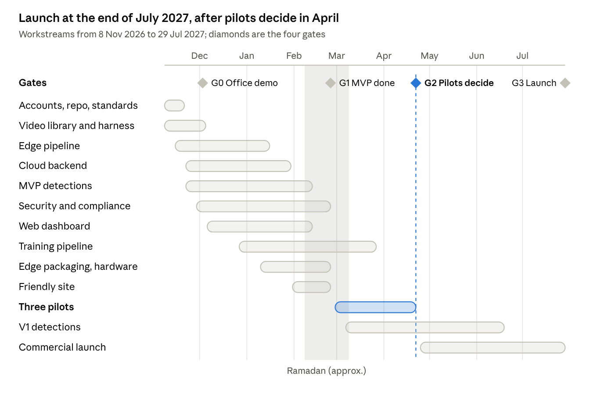

# Code-Ox Vision — Development Task Plan

_Last updated: 2 November 2026 · Owner: Shabeeb (Product owner)_

Every task from an empty repository to the first paying customers, in build order, with an owner, an estimate, what it depends on and when it counts as done.

## How to use this plan

The build runs 38 weeks, from **week 1 (starting Sunday 8 November 2026)** to commercial launch at the end of **July 2027**, in 14 phases that overlap. Each task has an ID, an owner role, an estimate in developer-days, what it depends on, and a "done when" test. Copy the tables into GitHub Issues or Jira as they are; the IDs are written to survive that.

**Phases at a glance**

| Phase | Name | Weeks | What exists at the end |
| --- | --- | --- | --- |
| 0 | Accounts, access, machines | 1 | Every developer can run Docker, Python and Claude Code; every outside account is applied for |
| 1 | Repository and standards | 1 to 2 | Monorepo, CLAUDE.md, CI, licence guard, coding rules |
| 2 | Video test library and evaluation harness | 1 to 4, then ongoing | 30+ labelled clips and one command that scores the whole system |
| 3 | Edge pipeline | 2 to 10 | Camera in, events out, running in Docker on a laptop |
| 4 | Cloud backend | 3 to 12 | Multi-tenant API, storage, alerts to WhatsApp and Telegram, VLM check |
| 5 | Web dashboard | 5 to 14 | Events with clips, true/false feedback, zone editor, Arabic and English |
| 6 | Detection use cases | MVP 3 to 14, V1 18 to 32 | Six MVP detections plus installer tools, then ten V1 detections, each passing its test clips |
| 7 | Model training pipeline | 8 to 20 | Labelling, training, export and release of our own fine-tuned models |
| 8 | Edge packaging and hardware | 10 to 16 | One installer image for Jetson and mini-PC, remote updates, remote access |
| 9 | Security, privacy, compliance | 4 to 16, launch check 36 | PDPL documents, encryption, access control, audit log |
| 10 | Testing and QA | Continuous, soak test 14 to 16 | Automated tests on every change, a 7-day soak passed |
| 11 | Office demo, friendly site, pilots | 4, 13 to 16, 17 to 24 | Live demo, one friendly site, three pilots measured |
| 12 | Commercial launch | 25 to 38 | Billing, in-Kingdom hosting, monitoring, support, installer kit |
| 13 | V2 backlog | 39 onwards | Odoo integration, mobile app, heatmaps, reseller portal |

**Task IDs.** Each phase has a prefix: SET (phase 0), REP (1), VID (2), EDG (3), CLD (4), WEB (5), DET (6), ML (7), HW (8), SEC (9), QA (10), PIL (11), LCH (12), V2 (13). A task's dependencies are listed by ID.

**Owner roles**

| Code | Role | Who |
| --- | --- | --- |
| PO | Product owner, Saudi lead | Shabeeb |
| LD | Lead developer (edge pipeline, architecture) | Strongest Python developer, existing team |
| CV | Senior computer-vision engineer | New hire or 6-month contractor |
| BE | Backend developer(s) | Existing team, 2 people |
| FE | Frontend developer | Existing team |
| DO | DevOps / MLOps | Existing team, part-time |
| QA | Quality assurance | Existing team, part-time |
| FLD | Field / installation engineer | Riyadh hire from week 14 |

**Estimates** are developer-days for one person using Claude Code, including writing tests. They assume Claude Code writes most of the first draft; reviewing, testing and fixing is the human time counted here. Add 20% for meetings and surprises when planning sprints.

**Priority.** **Must** = needed for the MVP and pilots. **Should** = needed for paid launch (V1). **Could** = V2, after launch.

**Definition of done (applies to every task)**

- [ ] Code merged to `main` through a pull request reviewed by one other person
- [ ] Unit tests written and passing in CI; video regression suite passing where the task touches detection, tracking or rules
- [ ] Runs inside its Docker container, not only on the developer's laptop
- [ ] No library outside the approved list (CI licence check green)
- [ ] Configuration in files or environment variables, no hard-coded secrets, IPs or customer names
- [ ] Any user-facing text in both English and Arabic string files
- [ ] README or docs updated if behaviour, setup or an API changed
- [ ] Shown working in the weekly demo

## Timeline

The workstreams run in parallel from 8 November 2026: the MVP is complete at the end of February 2027, three pilots decide the go in April, and commercial launch lands at the end of July 2027.



Edge pipeline, cloud backend and MVP detections are the critical path to gate 1; the video library keeps growing every week after week 4 and testing runs throughout. Week *n* starts on Sunday 8 November 2026 plus 7 × (*n* − 1) days; the India team works Monday to Friday of the same week.

## Team and working model with Claude Code

Six to seven people build this, most part-time from the existing team, and Claude Code writes most first drafts. What keeps it coherent is one repository, one `CLAUDE.md` that every session reads, small pull requests, and a video test suite that tells everyone the truth about accuracy.

**Who works on what, and how much**

| Role | Weeks 1 to 4 | Weeks 5 to 16 (MVP) | Weeks 17 to 38 (pilots, V1) |
| --- | --- | --- | --- |
| PO | 30%: accounts, videos, office camera, decisions | 30%: weekly demo, friendly site, pilot sales | 50%: pilots, pricing, customers |
| LD | 100% | 100% | 100% |
| CV | 50% (contractor start) | 100% | 100% |
| BE ×2 | 1 person 50% | 2 people 100% | 1 person 100%, 1 person 50% |
| FE | 0% | 100% from week 5 | 100% |
| DO | 25% | 50% | 50% |
| QA | 25% | 50% | 50% |
| FLD |  | from week 14 | 100% |

**Claude Code ground rules**

1. **One `CLAUDE.md` at the repo root** (task REP-03) holds the architecture, folder map, approved libraries, banned libraries, naming rules, how to run tests and the "no faces, no video leaves the site" rule. Every package folder (`edge/`, `cloud/`, `web/`, `ml/`) has its own short `CLAUDE.md` for local rules.
2. **Plan first, then code.** For any task above 1 day, the developer asks Claude Code for a written plan, pastes it into the GitHub issue, and only then lets it write code.
3. **One task, one branch, one pull request.** Branch name `<task-id>-short-name` (e.g. `EDG-04-rules-engine`). Pull requests stay under \~400 changed lines; bigger ones get split.
4. **Claude writes the tests too.** A task is not done until Claude Code has written unit tests and, for detection work, a video regression case.
5. **Custom slash commands** checked into `.claude/commands/`: `/test-videos` (run the clip suite and print the scorecard), `/new-rule` (scaffold a rule type with tests and a test-clip entry), `/new-detection` (scaffold a detection use case end to end), `/licence-check`.
6. **Subagents.** Reuse the team's existing reviewer and tester subagents; add a `video-evaluator` subagent whose only job is to run the harness and explain regressions.
7. **Never let Claude install a library that is not on the approved list.** CI blocks it anyway (REP-07); the rule saves the wasted afternoon.
8. **Secrets** live in `.env` files that are never committed, and in GitHub Actions secrets for CI.

**Branching and releases**

- `main` is always deployable. Feature branches merge into `main` after review and green CI.
- Edge and cloud get version tags (`edge-v0.3.0`, `cloud-v0.3.0`); models get their own tags (`model-person-v1`).
- Every merge to `main` builds Docker images; the office demo site updates itself nightly from `main` from week 5.

**Rituals**

| Ritual | When | Who | Output |
| --- | --- | --- | --- |
| Stand-up | Daily, 15 min, India morning | Dev team | Blockers raised |
| Sprint planning | Every 2 weeks, Sunday/Monday | All + PO | Tasks pulled from this plan into the sprint |
| Weekly demo | Thursday | All + PO | Working software shown on real or recorded video, scorecard read out |
| Scorecard review | Weekly, with the demo | LD, CV, PO | Caught/missed/false-alert numbers per detection, trend vs last week |
| Retro | End of each sprint | Dev team | One process change |

## Phase 0 — Accounts, access and machines (week 1)

All Must. About 12 developer-days of effort, but three items have outside waiting time (WhatsApp verification, the CV hire, client footage), so they start on day one even though nothing waits on them until later.

| ID | Task | Owner | Days | Needs | Done when |
| --- | --- | --- | --- | --- | --- |
| SET-01 | Name the people in each role (PO, LD, BE ×2, FE, DO, QA) and their time share | PO | 0.5 |  | Names written in this plan and in the GitHub team |
| SET-02 | Hire or contract the senior CV engineer: job description, shortlist, a paid take-home task (read a clip, detect people, count them in a zone, export a CSV), technical interview | PO, LD | 5 (spread over 3 weeks) |  | Contract signed, start date set |
| SET-03 | Create GitHub organisation repo `codeox-vision` (private), teams, branch protection on `main` (review + green CI required) | DO | 0.5 |  | Repo exists, protection on |
| SET-04 | Developer machine setup script `scripts/setup-dev.sh` for macOS, Ubuntu and Windows WSL2: Python 3.11, Docker Desktop, Node 20, Git, FFmpeg, MediaMTX, VS Code, Claude Code | DO | 1 | SET-03 | A new developer goes from blank laptop to running the test suite in under 2 hours |
| SET-05 | Confirm Claude Code access for every developer; commit shared project settings in `.claude/settings.json` | DO | 0.25 | SET-03 | Each developer has opened the repo in Claude Code |
| SET-06 | Anthropic Console account and API keys for the vision-language check: separate dev and production keys, monthly spend limit | PO | 0.25 |  | Keys in the secrets vault, limit set |
| SET-07 | Telegram bot via BotFather plus a "Vision Dev Alerts" group | LD | 0.25 |  | Test message arrives in the group from a script |
| SET-08 | WhatsApp Cloud API: Meta Business verification, dedicated phone number, display name approval, three utility templates in English and Arabic (alert with image, daily summary, system warning) | PO | 1 (+1 to 3 weeks waiting) |  | Templates approved; a test alert reaches the PO's phone |
| SET-09 | Staging server (8 vCPU, 32 GB RAM, 200 GB disk) with Docker, firewall, backups; DNS `staging.vision.code-ox.com` and `vision.code-ox.com` with TLS | DO | 0.5 |  | Server reachable over HTTPS, nightly backup running |
| SET-10 | Roboflow free workspace and RunPod account with a monthly spend cap for training GPUs | CV | 0.25 | SET-02 | Both accounts in the vault |
| SET-11 | Office NVR access: admin login, channel list, sub-stream set to 1280×720, 10 fps, H.264 on 2 to 4 cameras; NVR on a fixed IP | PO, DO | 1 |  | `ffprobe` reads the sub-stream from a laptop on the office network |
| SET-12 | Secure remote access to the office cameras for the India team: Tailscale on a small always-on office machine that relays RTSP | DO | 0.5 | SET-11 | A developer in India plays the office stream in VLC |
| SET-13 | Shared secrets vault (Bitwarden or 1Password) with folders per environment | DO | 0.25 |  | All keys from SET-06 to SET-12 stored there, none in chat |
| SET-14 | GitHub Projects board: import every task in this plan, labels per phase and priority, sprint field | PO, LD | 0.5 | SET-03 | Board shows all tasks with IDs |
| SET-15 | Ask 2 to 3 friendly clients (restaurant, shop, warehouse) for 1 to 2 hours of exported CCTV footage each, from busy and quiet periods, day and night | PO | 1 | SET-16 | Footage received for at least 2 sites |
| SET-16 | Footage consent letter: what we use it for (testing and training only), where it is stored, deletion on request, no faces used for identification | PO | 0.5 |  | Signed by each client before footage is handed over |

## Phase 1 — Repository and standards (weeks 1 to 2)

All Must, about 11 developer-days, mostly LD and DO. This phase decides how every later task is written, so it is done before feature work starts. The most important single file is the shared event and rule schema (REP-04): edge, cloud and dashboard all speak it.

**Repository layout (one monorepo)**

```
codeox-vision/
  CLAUDE.md                 root rules every Claude Code session reads
  edge/                     runs at the customer site (Python)
    ingest/                 camera streams, reconnects, frame sampling
    inference/              detector runtime (PyTorch dev, ONNX/TensorRT prod)
    tracking/               ByteTrack, zones, lines, dwell
    rules/                  rule types, evaluator, cooldowns
    clips/                  ring buffer, snapshot and clip cutting
    uploader/               event + clip upload, offline queue
    agent/                  heartbeat, config/model pull, logs, self-update
  cloud/                    API, workers, alert dispatcher (Python, FastAPI)
  web/                      dashboard (React, Vite, TypeScript)
  ml/                       datasets, training, export, model registry
  shared/                   Event, Rule, Camera, Site schemas (pydantic -> JSON Schema -> TypeScript)
  test-videos/              manifest.yaml + expected results (clips live in object storage)
  deploy/                   docker-compose files, edge image build, Ansible
  docs/                     ADRs, approved libraries, runbooks
  .claude/commands/         /test-videos, /new-rule, /new-detection, /licence-check
  .claude/agents/           video-evaluator subagent
```

| ID | Task | Owner | Days | Needs | Done when |
| --- | --- | --- | --- | --- | --- |
| REP-01 | Create the folder layout above with a placeholder README in each folder | LD | 0.25 | SET-03 | Layout merged |
| REP-02 | Python tooling: `uv` for environments, `ruff` for lint and format, `mypy` for types, `pytest`, `pre-commit` hooks. Web tooling: `pnpm`, ESLint, Prettier, Vitest | LD | 1 | REP-01 | `pre-commit run --all-files` and `pnpm lint` pass on a clean clone |
| REP-03 | Root `CLAUDE.md`: product summary, architecture diagram in text, folder map, approved and banned libraries, naming rules, how to run each service and test, the privacy rules (no face recognition, no identity tracking, video never leaves the site), "plan before code" rule. Short `CLAUDE.md` in `edge/`, `cloud/`, `web/`, `ml/` | LD | 1 | REP-01 | A fresh Claude Code session, asked "how do I add a rule type", answers correctly from the file |
| REP-04 | Shared schemas in `shared/`: `Detection`, `Track`, `Zone` (polygon in normalised 0–1 coordinates), `Line`, `Rule` (type, camera, zone, condition, schedule, cooldown, severity), `Event` (id, site, camera, rule, time, snapshot key, clip key, attributes), `CameraConfig`, `SiteConfig`. Generate JSON Schema and TypeScript types from them | LD, BE | 2 | REP-01 | Edge, cloud and web import the same generated types; a schema change breaks the build if a consumer is not updated |
| REP-05 | `deploy/docker-compose.dev.yml`: PostgreSQL 16, Redis 7, MinIO, MediaMTX (plays test clips as fake RTSP cameras), cloud API, edge service, web | DO | 1.5 | REP-01 | `docker compose up` brings the whole system up on a laptop with 4 fake cameras |
| REP-06 | CI in GitHub Actions: on each pull request run lint, type check, unit tests, schema generation check, licence check, Docker builds; nightly run of the full video regression suite with the scorecard posted to the Telegram dev group | DO | 1.5 | REP-02, REP-07 | Red CI blocks merge; nightly scorecard arrives |
| REP-07 | Licence guard: `pip-licenses` and `license-checker` against an allowlist (MIT, BSD, Apache-2.0, ISC, PSF, MPL-2.0); hard block on AGPL/GPL and on the names `ultralytics`, `boxmot`, `deep_sort`, `yolo-world`, `yolo-nas`, `deimv2` | DO | 0.5 | REP-02 | A test pull request that adds `ultralytics` fails CI |
| REP-08 | `docs/approved-libraries.md`: every allowed library, its licence and why we use it (seed list: rfdetr, supervision, opencv-python, torch, onnxruntime, numpy, pydantic, httpx, fastapi, uvicorn, sqlalchemy, alembic, psycopg, redis, boto3, anthropic, structlog; web: react, vite, tailwind, react-konva, react-i18next, tanstack-query) | LD | 0.25 |  | List merged and linked from CLAUDE.md |
| REP-09 | Configuration convention: `pydantic-settings` per service, `.env.example` per package, no secrets in Git, settings validated at start-up with a clear error | LD | 0.5 | REP-02 | A missing setting stops the service with a readable message |
| REP-10 | Logging convention: JSON logs via `structlog`, correlation ID per event and request, all times stored in UTC and shown in Asia/Riyadh | LD | 0.5 | REP-02 | Logs from edge and cloud for the same event share one ID |
| REP-11 | Claude Code commands and subagent: `/test-videos`, `/new-rule`, `/new-detection`, `/licence-check`, and a `video-evaluator` subagent that runs the harness and explains regressions | LD | 0.5 | REP-03, VID-05 | Each command works from a clean clone |
| REP-12 | Architecture decision records in `docs/adr/`: 001 edge-first processing, 002 RF-DETR instead of YOLO, 003 no face recognition, 004 PostgreSQL + object storage, 005 WhatsApp as primary alert channel, 006 per-site pricing drives plan limits | LD | 0.5 |  | Six ADRs merged |
| REP-13 | Pull request and issue templates carrying the task ID and the definition-of-done checklist; `CODEOWNERS` per folder | DO | 0.25 | REP-01 | New pull requests open with the checklist |
| REP-14 | Versioning: semantic version tags per component (`edge-v`, `cloud-v`, `web-v`, `model-`), automatic changelog from pull request titles | DO | 0.25 | REP-06 | First tags `v0.1.0` cut |

## Phase 2 — Video test library and evaluation harness (weeks 1 to 4, then ongoing)

All Must, about 16 developer-days plus PO time to collect and stage footage. This is our test suite: a folder of real CCTV clips, each with the alerts it should and should not produce, and one command that scores the whole system against them. It is built first so every later change is measured, and it grows every week from office recordings, client footage and every pilot mistake.

**What a test clip carries (manifest entry)**

```yaml
- id: rest-queue-001
  file: s3://cv-test-videos/rest-queue-001.mp4
  source: friendly-client-A (consent letter on file)
  scene: restaurant counter
  angle: ceiling corner, 3 m
  lighting: day
  resolution: 1280x720
  fps: 10
  duration_s: 300
  zones:
    counter_queue: [[0.12,0.55],[0.48,0.52],[0.52,0.95],[0.10,0.98]]
  rules: [queue_length_over]          # rules to run on this clip
  expected:
    - rule: queue_length_over
      start_s: 84
      end_s: 190
      tolerance_s: 15
  must_not_fire: [after_hours_presence]
  notes: thobes and abayas, glass reflection on left
```

**Minimum library before each gate**

| Gate | Clips | Mix |
| --- | --- | --- |
| Office demo (week 4) | 30 | 5 MVP rule types × 3 positive + 3 negative |
| MVP done (week 16) | 80 | Plus night/IR, crowded, overhead fisheye, reflections, 2 real client sites |
| V1 launch (week 38) | 200+ | Every V1 detection × 10 positive + 10 hard negatives, every pilot site represented |

| ID | Task | Owner | Days | Needs | Done when |
| --- | --- | --- | --- | --- | --- |
| VID-01 | Write the clip catalogue: for each MVP and V1 rule type, the positive scenes, the hard negatives (looks similar but must not fire) and the conditions to cover (day, night IR, crowded, empty, overhead, side angle, glass reflections) | PO, CV | 1 |  | Catalogue table in `test-videos/README.md` |
| VID-02 | Manifest schema (above) as a pydantic model in `shared/`, with validation in CI | LD | 0.5 | REP-04 | A malformed manifest entry fails CI |
| VID-03 | Clip storage: private bucket `cv-test-videos` on MinIO (dev) and S3-compatible storage (staging), `make fetch-videos` downloads with checksums; clips never committed to Git | DO | 0.5 | SET-09 | A new developer fetches all clips with one command |
| VID-04 | Staged office recordings: write a short script per scenario and act it out on the office cameras (queue forming and clearing, entering a restricted zone, loitering, after-hours entry, line crossing in both directions, helmet and vest on/off, hairnet on/off, boxes blocking an exit, wet-floor sign). Buy props: 3 helmets, 3 high-vis vests, hairnets, gloves, wet-floor sign, cardboard boxes (about SAR 400) | PO, QA | 3 | SET-11 | 40 staged clips recorded at 720p sub-stream and 1080p main stream |
| VID-05 | Evaluation harness `ml/eval/run.py`: runs the real edge pipeline on each clip through a file source (same code path as live), collects events, matches them to `expected` within tolerance, and reports per rule type: caught, missed, false alerts, precision, recall, false alerts per camera-hour, alert delay, and frames per second processed. Outputs JSON plus a Markdown scorecard and a diff against the last baseline | LD, CV | 4 | VID-02, EDG-09 | `/test-videos` prints the scorecard for all clips in under 15 minutes on a laptop |
| VID-06 | Event-marking tool `ml/tools/mark_events.py`: play a clip, press keys to mark event start/end per rule, draw zones with the mouse, write the manifest entry | CV | 1.5 | VID-02 | Marking a 5-minute clip takes under 10 minutes |
| VID-07 | Client footage intake: receive files, check consent letter, convert to 720p H.264 at 10 fps with FFmpeg, cut into 2 to 10 minute clips, mark events, upload | QA | 2 | SET-15, VID-06 | Clips from at least 2 client sites in the library |
| VID-08 | Public footage, licence-checked: free commercial-use stock CCTV-style videos (e.g. Pexels) for variety; academic datasets (MOT, VIRAT) only if their licence allows commercial evaluation, otherwise skipped | CV | 1 | VID-02 | Each external clip has its licence recorded in the manifest |
| VID-09 | Saudi-specific coverage: people in thobes, abayas and niqab, families with children, prayer-time empty stores, Ramadan night crowds, mirrored shop fronts, harsh midday sun through glass | PO, QA | 1 | VID-04 | At least 15 clips tagged `saudi-context` |
| VID-10 | Baseline and regression thresholds: record the first baseline; the nightly run fails if any rule's recall drops more than 3 points or false alerts per camera-hour rise more than 20% | LD | 0.5 | VID-05, REP-06 | A deliberately broken threshold turns the nightly run red |
| VID-11 | Library privacy: access limited to the dev team, consent letters linked per source, deletion on client request within 7 days, an optional face-blur script for clips used in sales demos | DO, PO | 1 | VID-03 | Access list and deletion runbook in `docs/` |
| VID-12 | Ongoing intake (weekly, from week 13): every confirmed miss and every false alert from the friendly site and pilots becomes a new clip with expected results | QA | 0.5/week | PIL-05 | Library grows every week; scorecard trend tracked |

## Phase 3 — Edge pipeline (weeks 2 to 10)

About 46 developer-days (LD, CV, BE). This is the software that runs at the customer site: it reads cameras, finds people and objects, applies the customer's rules, and sends events with a snapshot and a short clip to the cloud. It starts as a 2-day throwaway prototype (EDG-01) that proves the whole loop, then gets rebuilt as proper services. Everything here runs in Docker and is tested on the fake cameras from REP-05 and the clips from Phase 2.

**Edge data flow:** camera → go2rtc → frame sampler (5 to 10 fps) → detector → tracker → zones and lines → rules engine → event + snapshot + clip → local outbox → cloud.

**MVP rule types (EDG-09)**

| Rule type | Fires when | Example |
| --- | --- | --- |
| `zone_occupancy_over` | More than N people in a zone for at least T seconds | Crowd at the pharmacy counter |
| `zone_empty` | Nobody in a zone for at least T minutes during scheduled hours | Cashier or reception desk unattended |
| `queue_length_over` | Queue zone holds more than N people; also reports estimated wait from dwell | Open a second till |
| `dwell_over` | Any one person or vehicle stays in a zone longer than T | Loitering, truck waiting at dock |
| `line_crossing` | Count of crossings in a direction exceeds N in a period, or any crossing into a restricted side | Entry counting, restricted door |
| `presence_after_hours` | Any person detected in a zone outside the schedule | Night intrusion, staff after closing |

Every rule has: camera, zone or line, threshold, minimum duration, schedule (days and hours, Asia/Riyadh time), cooldown, severity (info, warning, critical), minimum confidence, and a clear-down condition so one situation produces one alert, not fifty.

| ID | Task | Owner | Days | Pri | Needs | Done when |
| --- | --- | --- | --- | --- | --- | --- |
| EDG-01 | Throwaway prototype, one script: read a file or RTSP stream with OpenCV, sample 5 fps, detect people with RF-DETR Nano on CPU, track with Supervision ByteTrack, count people in one polygon, fire when more than 3 for 30 s, send snapshot to Telegram | LD | 2 | Must | SET-07 | The queue clip alerts and the empty-counter clip does not; shown in week 2 demo |
| EDG-02 | Frame source service: `FileSource` and `RtspSource` behind one interface; target fps sampling; wall-clock timestamp per frame; reconnect with exponential backoff (1 s to 60 s); stalled-stream detection (no frame for 10 s); per-camera health (online, real fps, resolution, codec, last frame time) | LD | 3 | Must | REP-04 | Unplugging a fake camera for 2 minutes and back recovers with no restart; health shows the gap |
| EDG-03 | go2rtc as the camera front door: generate its config from `CameraConfig`, one connection per camera, local restream for inference, JPEG snapshot endpoint for the zone editor | LD | 1 | Must | EDG-02 | Each camera opens exactly one session on the NVR |
| EDG-04 | Camera discovery: ONVIF WS-Discovery scan, `GetProfiles` / `GetStreamUri`, fallback URL templates for Hikvision, Dahua, Uniview, Axis and Hanwha NVRs and cameras, credential test, sub-stream selection, report of resolution and codec per channel | BE | 3 | Should | EDG-02 | Office NVR channels discovered automatically with working sub-stream URLs |
| EDG-05 | Inference worker: `Detector` interface with three backends (PyTorch CPU for development, ONNX Runtime CPU/GPU, TensorRT on Jetson); batches frames from all cameras; letterbox resize; class and confidence filtering; latency measured per batch | CV | 4 | Must | REP-04 | Same clip gives the same detections (within tolerance) on all three backends |
| EDG-06 | Model packaging on the edge: model file plus manifest (name, version, classes, input size, checksum, licence); hot-swap a model without restarting the pipeline; refuse a model whose checksum fails | CV | 1.5 | Must | EDG-05 | Swapping person-v1 for person-v2 mid-run drops no frames beyond 2 s |
| EDG-07 | Tracking: Supervision ByteTrack per camera, track lifecycle (new, active, lost, removed), per-camera tuning of thresholds, optional motion gating so inference is skipped on still frames | CV | 2 | Must | EDG-05 | Person IDs stay stable through a 3-second occlusion on the test clips |
| EDG-08 | Zones and lines: polygons and lines stored in normalised 0–1 coordinates and scaled per camera; anchor point per class (bottom-centre for people, centre for objects); several zones per camera; zone membership and time-in-zone per track | LD | 1.5 | Must | EDG-07 | Unit tests cover edge-of-zone and crossing-back cases |
| EDG-09 | Rules engine: plugin interface `evaluate(state, now) → Event \| None`; the six MVP rule types above; schedules, cooldowns, severity, hysteresis (armed → triggered → cleared); rules loaded from site config and reloaded live | LD | 6 | Must | EDG-08 | Each rule type has unit tests plus at least 3 positive and 3 negative test clips passing |
| EDG-10 | Counters and aggregates: per camera per minute occupancy, entries and exits, queue length average and maximum, average dwell; stored locally and uploaded in batches every 5 minutes for reports and footfall | LD | 2 | Must | EDG-09 | One hour of office footage produces a correct per-minute footfall table |
| EDG-11 | Clip and snapshot service: rolling 30-second buffer per camera kept as encoded 2-second segments in RAM disk (no re-encoding while idle); on event, cut 5 s before to 5 s after into an MP4 (H.264, 720p); snapshot JPEG with boxes and zone drawn | LD | 3 | Must | EDG-03, EDG-09 | Event clip starts before the trigger and plays in WhatsApp and in a browser |
| EDG-12 | Event uploader with outbox: events queued in local SQLite, uploaded with snapshot and clip through pre-signed URLs, idempotency key per event, retries with backoff, ordered delivery; offline mode keeps events for 7 days and clips up to a disk quota (oldest clips dropped first, events never) | BE | 3 | Must | CLD-05 | Pulling the internet for 2 hours then restoring delivers every event once, in order |
| EDG-13 | Edge agent: enrolment with a one-time token; heartbeat every 60 s (CPU, GPU, temperature, RAM, disk, per-camera status, software and model versions); pulls site config and rules (ETag polling every 60 s) and applies without restart; reports applied config version; downloads new models; uploads recent logs on request | BE | 4 | Must | CLD-04 | Changing a rule in the cloud takes effect on the box within 2 minutes |
| EDG-14 | Watchdog and self-protection: Docker restart policies, health endpoint per service, disk guard (delete oldest clips above 80% use), thermal guard (lower fps above 80 °C), camera-down event after 5 minutes offline | DO | 2 | Must | EDG-13 | Killing any service restarts it within 30 s and logs why |
| EDG-15 | Installer page on the box (LAN only, password protected): camera list with snapshots, zones drawn, live counts, health; used by the field engineer during setup | FE | 2 | Should | EDG-03 | Field engineer verifies a site without cloud access |
| EDG-16 | Performance budget and profiling: time per stage (decode, detect, track, rules, encode); targets 8 cameras at 5 fps on Orin Nano, 16 on Orin NX, 24 on RTX 4060; profiling report in `docs/` | CV | 2 | Must | EDG-05, HW-02 | Report shows measured cameras-per-box for each hardware tier |
| EDG-17 | Time sync: chrony/NTP on the box; all event times from the box clock, never the camera clock | DO | 0.5 | Must |  | Event times match wall clock within 1 s |
| EDG-18 | Offline-only mode: the box can run entirely from a local `site.yaml` with no cloud (for hospitals and government), events kept on box and visible on the installer page | LD | 1 | Should | EDG-13, EDG-15 | Box runs a full day with the network cable to the internet removed |
| EDG-19 | Privacy guards in code: no face crops or face embeddings anywhere; snapshots on the box deleted after 24 h; clips only for triggered events; site flag "events only, no clips" for sensitive sites | LD | 1 | Must | EDG-11 | Code review checklist item; test proves the flag stops clip upload |

## Phase 4 — Cloud backend (weeks 3 to 12)

About 46 developer-days (BE ×2, DO, CV for the VLM check). The cloud never sees live video: it receives events, snapshots, clips and per-minute counts from edge boxes, decides who gets alerted and how, stores feedback, and serves the dashboard. Stack: FastAPI, PostgreSQL 16, Redis, S3-compatible object storage, one worker process for background jobs.

**Core data model**

| Table | Holds |
| --- | --- |
| `organisations` | Customer company, plan, language, time zone |
| `users`, `memberships` | People, their role per organisation and per site |
| `sites` | Branch or building; address, opening hours, plan limits |
| `devices` | Edge boxes: enrolment, hardware tier, versions, last heartbeat |
| `cameras` | Name, stream URL (encrypted), resolution, status, snapshot |
| `zones`, `lines` | Normalised geometry per camera |
| `rules` | Type, parameters, schedule, cooldown, severity, verify flag, recipients |
| `events` | Rule, camera, time, attributes, snapshot and clip keys, VLM verdict, status |
| `event_feedback` | True / false, by whom, through which channel, when |
| `recipients`, `notifications` | Who gets which alerts on which channel; every delivery attempt and its status |
| `aggregates_minute` | Counts per camera per minute (occupancy, in/out, queue, dwell) |
| `config_versions`, `model_releases` | What config and model each device should run |
| `audit_log` | Every change to rules, zones, recipients and every clip viewed |

Every customer-owned table carries `organisation_id`, and access is filtered on it both in code and by PostgreSQL row-level security.

| ID | Task | Owner | Days | Pri | Needs | Done when |
| --- | --- | --- | --- | --- | --- | --- |
| CLD-01 | Database schema and Alembic migrations for the tables above, seed data for one demo organisation | BE | 3 | Must | REP-04 | `alembic upgrade head` builds the schema; seed loads |
| CLD-02 | Multi-tenancy and permissions: roles Code-Ox admin, organisation owner, manager, site manager, viewer; per-site access; PostgreSQL row-level security as the second lock | BE | 3 | Must | CLD-01 | Automated test: a user of organisation A cannot read any row of organisation B through any endpoint |
| CLD-03 | Login: email and password (argon2), invitation flow, password reset, optional authenticator-app 2FA, short-lived access token plus refresh token. Library choice recorded as an ADR (`fastapi-users` or Keycloak) | BE | 3 | Must | CLD-02 | Invite, sign-in, reset and 2FA work end to end |
| CLD-04 | Device API: enrolment with one-time token → device credential; heartbeat ingest; config endpoint with ETag; model release endpoint; log upload endpoint | BE | 3 | Must | CLD-01 | An edge box enrols, heartbeats and pulls config against staging |
| CLD-05 | Event ingest API: idempotent create, pre-signed upload URLs for snapshot and clip, finalise call, aggregates batch ingest, schema validation, rate limit per device | BE | 2 | Must | CLD-04 | Duplicate event submissions create one event; a 10,000-event burst is accepted |
| CLD-06 | Object storage: key layout `org/site/camera/yyyy/mm/dd/event`, server-side encryption, lifecycle rules (clips 30 days default, 7 to 90 by plan; snapshots 90 days), signed view URLs valid 5 minutes, delete-on-request job | DO, BE | 1.5 | Must | SET-09 | Expired clips disappear on schedule; a direct bucket URL without signature is refused |
| CLD-07 | Management API for the dashboard: CRUD for sites, cameras, zones, lines, rules, recipients; event list with filters (site, camera, rule, severity, date, status, verified) and pagination; event detail; feedback; aggregates queries; OpenAPI docs | BE | 4 | Must | CLD-02 | Dashboard team builds against the generated client with no hand-written calls |
| CLD-08 | Alert dispatcher worker: takes new events from a Redis queue; picks recipients by site, rule, severity and schedule; quiet hours; grouping (same camera and rule within 2 minutes becomes one alert with a count); daily cap per recipient; escalation (unacknowledged critical alert goes to the next person after 10 minutes); retries; delivery log | BE | 5 | Must | CLD-05, CLD-17 | Test: 30 events in 2 minutes from one camera produce one grouped alert |
| CLD-09 | WhatsApp channel: Cloud API client, template messages with image header and two quick-reply buttons ("Correct" / "False alarm"), English or Arabic per recipient, webhook for replies and delivery status with signature check, recipient opt-in record | BE | 3 | Must | SET-08, CLD-08 | Alert with snapshot reaches a phone; tapping "False alarm" updates the event within 5 s |
| CLD-10 | Telegram channel: bot, linking a recipient with a one-time code, photo plus inline buttons, callback handling | BE | 1 | Must | SET-07, CLD-08 | Same as CLD-09 on Telegram |
| CLD-11 | Feedback loop: store every true/false answer; per-rule and per-camera precision; events marked false or later found missed go into a review queue for the video library and labelling | BE | 1.5 | Must | CLD-09 | Precision per rule visible through the API |
| CLD-12 | VLM second opinion: for rules with `verify: true`, send the zone crop of the snapshot with a rule-specific yes/no question to Claude Haiku (Anthropic API), expect JSON `{answer, confidence, reason}`, suppress or downgrade on "no", time out after 8 s and send marked "unverified"; monthly cost cap per organisation; provider interface so a self-hosted Qwen3-VL can replace it; prompts versioned in the repo with a test set of stored snapshots | BE, CV | 4 | Must | CLD-08, SET-06 | On the spill and empty-shelf test snapshots the check removes at least half the false alerts without hiding true ones |
| CLD-13 | Daily WhatsApp summary per site at 21:00 Riyadh (alerts by type, top cameras, false-alert rate, busiest hour) | BE | 2 | Must | CLD-08 | Summary arrives daily on the office demo site |
| CLD-14 | Weekly PDF report per site by email (charts of alerts, footfall, queue times, feedback), Arabic and English | BE | 2 | Should | CLD-13 | Report renders correctly in both languages |
| CLD-15 | Fleet operations: Code-Ox admin endpoints for all devices, last heartbeat, versions, cameras offline; alert to the Code-Ox ops Telegram group when a device is silent 10 minutes or a camera 30 minutes | BE | 1.5 | Must | CLD-04 | Unplugging the office box alerts ops within 11 minutes |
| CLD-16 | Audit log of rule, zone and recipient changes and of every clip viewed (who, when, from where) | BE | 1 | Must | CLD-07 | Log entries visible to organisation owners |
| CLD-17 | Background job infrastructure: Redis queue, worker process (`arq` or `rq`), scheduler for timed jobs, dead-letter handling | BE | 1 | Must | REP-05 | A failing job retries 3 times then lands in dead-letter with its error |
| CLD-18 | Plan limits: Starter 4 cameras, Standard 8, Business 16, Enterprise 32; clip retention and features per plan; enforced on camera creation | BE | 1 | Should | CLD-07 | Adding a 5th camera on Starter is refused with an upgrade message |
| CLD-19 | API hardening: rate limits, input validation, CORS, consistent error format, request IDs, security headers | BE | 1 | Must | CLD-07 | OWASP ZAP baseline scan shows no high findings |
| CLD-20 | Staging deployment: Docker Compose on the staging server behind Caddy (TLS), nightly PostgreSQL backup to object storage with a tested restore, migrations on deploy, health checks, deploy from CI on tag | DO | 2 | Must | SET-09, REP-06 | A tag deploys to staging with no manual step; restore drill passes |

## Phase 5 — Web dashboard (weeks 5 to 14)

About 38 developer-days (FE, with BE support). Most managers will live in WhatsApp; the dashboard is where owners set things up, review clips, see trends and where Code-Ox runs the fleet. Arabic and English from the first screen, right-to-left done properly, and it must work on a phone because managers tap through from WhatsApp. Stack: React, Vite, TypeScript, Tailwind, TanStack Query, React Router, `react-konva` for drawing, `react-i18next`, an API client generated from the backend's OpenAPI.

**Screens**

| Screen | Used by | Purpose |
| --- | --- | --- |
| Sign-in, invite, reset, 2FA | Everyone | Access |
| Site overview | Owner, manager | Today's alerts by type, false-alert rate, footfall by hour, queue trend, camera status |
| Event feed | Manager | Live list of alerts with thumbnails and filters |
| Event detail | Manager | Clip, snapshot, rule, AI check verdict and reason, true/false buttons, notes |
| Cameras | Owner, Code-Ox installer | Cameras per site, health, snapshot, add/edit |
| Zone editor | Owner, installer | Draw zones and lines on the camera snapshot |
| Rule builder | Owner, manager | Create rules from templates, with a plain-language preview |
| Recipients | Owner | Who is alerted, on which channel, quiet hours |
| All sites | Owner of a chain | Every branch in one table |
| Users and roles, audit log | Owner | Access control and accountability |
| Code-Ox admin console | Code-Ox ops | Organisations, devices, enrolment tokens, model rollout, support view |

| ID | Task | Owner | Days | Pri | Needs | Done when |
| --- | --- | --- | --- | --- | --- | --- |
| WEB-01 | Scaffold the web app: Vite, TypeScript, Tailwind, React Router, TanStack Query, generated API client, auth token handling with refresh | FE | 1.5 | Must | CLD-07 | App builds in CI and calls staging |
| WEB-02 | Design basics: colour and type scale, Arabic-capable font (e.g. IBM Plex Sans Arabic), buttons, forms, tables, modals, empty and error states, light theme | FE | 2 | Must | WEB-01 | Component page reviewed by PO |
| WEB-03 | Arabic and English: `react-i18next`, every string in `en.json` and `ar.json`, right-to-left layout switch, Arabic or Western digits option, dates in Asia/Riyadh; CI check that fails on missing translation keys | FE | 1.5 | Must | WEB-01 | Every screen reviewed in Arabic by a native speaker |
| WEB-04 | Sign-in, invitation acceptance, password reset and 2FA screens | FE | 1.5 | Must | CLD-03 | Full flow works on staging |
| WEB-05 | Event feed: refreshes every 10 s (server-sent events later), filters by site, camera, rule, severity, date, status and verified; severity colours; thumbnails; infinite scroll | FE | 3 | Must | CLD-07 | 1,000 events scroll smoothly on a mid-range phone |
| WEB-06 | Event detail: clip player, snapshot with boxes and zone, rule summary, AI check verdict and reason, "Correct" / "False alarm" buttons, note field, link to the camera | FE | 2 | Must | WEB-05 | Feedback given here shows in the API precision figures |
| WEB-07 | Sites and cameras: list, add camera by URL or from edge discovery (EDG-04), status and last frame time, snapshot refresh | FE | 2 | Must | CLD-07 | A camera is added and goes online without touching the database |
| WEB-08 | Zone and line editor: draw, move, reshape and delete polygons and lines on the latest snapshot; names and colours; saves normalised coordinates; shows live count per zone when the box reports it | FE | 4 | Must | WEB-07 | Installer draws three zones on a real camera in under 3 minutes |
| WEB-09 | Rule builder: choose a rule type or an industry template, then a form per type (threshold, duration, schedule by day and hour, cooldown, severity, AI check on/off, recipients); plain-language preview such as "Alert Store Manager on WhatsApp when more than 5 people wait in Checkout Queue for 2 minutes, daily 09:00–23:00" | FE | 4 | Must | WEB-08 | A non-technical person creates a working queue rule unaided |
| WEB-10 | Recipients: add people with WhatsApp number (opt-in captured), Telegram link code, email; assign to rules; quiet hours; language per recipient | FE | 2 | Must | CLD-09 | New recipient receives a test alert from the screen |
| WEB-11 | Site overview: alerts today by type, false-alert rate this week, footfall by hour chart, queue length trend, cameras online | FE | 3 | Must | CLD-07, EDG-10 | Overview for the office demo matches the scorecard numbers |
| WEB-12 | All-sites view for chains: one row per site with status, alerts today, false-alert rate, worst camera | FE | 1.5 | Should | WEB-11 | Works with 20 demo sites |
| WEB-13 | Users and roles: invite, change role, limit to sites, remove | FE | 1.5 | Must | CLD-02 | Removed user loses access immediately |
| WEB-14 | Audit log viewer with filters | FE | 0.5 | Should | CLD-16 | Owner sees who changed a rule and when |
| WEB-15 | Code-Ox admin console: organisations, devices and their health, enrolment token generator, model rollout per device group, read-only support view of a customer (audited) | FE | 3 | Must | CLD-15 | Ops enrols and monitors a box without database access |
| WEB-16 | Phone layout for every manager screen (feed, detail, overview) | FE | 1.5 | Must | WEB-06 | Usable one-handed on a 6-inch phone |
| WEB-17 | Deep link from WhatsApp: a signed link that opens one event for 24 h without full sign-in, scoped to that event only, logged in the audit log | BE, FE | 1 | Must | CLD-09 | Link opens on the phone; editing the link to another event fails |
| WEB-18 | Performance and accessibility pass: bundle size budget, lazy-loaded clips, keyboard navigation, contrast | FE | 1 | Should | WEB-11 | Lighthouse score 90+ on the overview page |

## Phase 6 — Detection use cases (MVP weeks 3 to 14, V1 weeks 18 to 32)

About 18 developer-days for the MVP set and 46 for the V1 set (CV and LD). Every use case is a combination of a model and a rule type from Phase 3, delivered with its test clips and an agreed pass mark. The MVP set needs **no training**: it uses the standard pretrained person and vehicle detector. The V1 set needs fine-tuned models (Phase 7) or the vision-language check (CLD-12).

**Pass marks, measured by the harness (VID-05) on the test library and on the 7-day office soak**

| Level | Caught (recall) | False alerts | Alert delay |
| --- | --- | --- | --- |
| MVP use case | 90% or more of expected events | No more than 1 per camera per 24 h | Under 60 s after the condition is met |
| V1 use case | 85% or more | After the AI check, 80% or more of alerts marked "Correct" by managers | Under 90 s (AI check included) |

**MVP set (pretrained detector, no training)**

| ID | Use case | Industries | How it works | Days | Pri | Needs | Pass mark |
| --- | --- | --- | --- | --- | --- | --- | --- |
| DET-01 | People count and zone occupancy | Retail, clinics, hotels, restaurants | Person detector + tracker + `zone_occupancy_over` | 2 | Must | EDG-09 | MVP marks on 10 clips |
| DET-02 | Queue length and estimated wait | Tills, pharmacy, check-in, food counters | `queue_length_over` + average dwell of people leaving the queue zone | 3 | Must | EDG-09 | Count within ±1 person 90% of the time; MVP marks |
| DET-03 | Unattended station | Cashier, reception, kitchen station, security post | `zone_empty` with schedule | 2 | Must | EDG-09 | MVP marks, including staff briefly stepping out (must not fire under the minimum time) |
| DET-04 | After-hours presence | Every industry | `presence_after_hours` with site opening hours | 2 | Must | EDG-09 | MVP marks, night IR clips included |
| DET-05 | Footfall in and out | Retail entrances, malls, clinics | `line_crossing` counting per direction, per-minute aggregates | 3 | Must | EDG-10 | Daily count within 5% of a manual count on 2 hours of footage |
| DET-06 | Loitering and dwell | Back doors, cash office, docks, car parks | `dwell_over` for people or vehicles | 2 | Must | EDG-09 | MVP marks |
| DET-07 | Camera suitability check | All (installer tool) | From a 2-minute sample: median person height in pixels, lighting, fps achieved; warns if people are under 40 px tall or fps under target | 2 | Must | EDG-05 | Correctly warns on the far-away and fisheye test cameras |
| DET-08 | Industry rule templates | All | Ready-made rule sets for restaurant, retail, clinic, hotel, warehouse, factory, each with sensible thresholds and schedules, in English and Arabic | 2 | Must | WEB-09 | A new restaurant site is configured from its template in under 15 minutes |

**V1 set (fine-tuned models or AI check)**

| ID | Use case | Industries | How it works | Days | Pri | Needs | Pass mark |
| --- | --- | --- | --- | --- | --- | --- | --- |
| DET-10 | Helmet and high-vis vest missing | Manufacturing, logistics, construction | RF-DETR Small fine-tuned on public PPE data plus our footage (classes: person, helmet, no-helmet, vest, no-vest); rule fires when a person in a PPE zone is without the item for 5 s; AI check on the crop | 6 | Should | ML-05 | V1 marks |
| DET-11 | Hairnet, gloves and uniform in kitchens | Restaurants, central kitchens, food factories | Fine-tuned head/hand classes plus AI check; compliance log per shift for municipality inspections | 6 | Should | ML-05 | V1 marks |
| DET-12 | Forklift too close to a person | Warehouses, factories | Fine-tuned forklift class; distance between boxes; optional 4-point floor calibration to measure metres; near-miss logged with clip | 6 | Should | ML-05 | V1 marks; no alert for a driver on his own forklift |
| DET-13 | Blocked aisle or fire exit | Warehouses, retail, hotels, hospitals | Object present in an exit zone for more than N minutes (boxes, pallets, trolleys) + AI check "is the exit path blocked?"; auto-clears when free | 4 | Should | CLD-12 | V1 marks |
| DET-14 | Empty shelf / gap on display | Supermarkets, pharmacies | Scheduled snapshot of shelf zones every 15 minutes during opening hours, AI check "are there visible empty gaps?"; later a fine-tuned gap detector | 5 | Should | CLD-12 | 80% of gaps flagged within 30 minutes; false alerts under 2 per shelf camera per day |
| DET-15 | Wet floor or spill | Supermarkets, malls, hotels, hospitals | Change detection on floor zones when no person is present + AI check; lower expectations documented | 5 | Should | CLD-12 | Recall 70%+ on spill clips; reported to customers as "assist", not guaranteed |
| DET-16 | Table needs clearing | Restaurants, cafés, food courts | Table zone empty of seated people for 2 minutes + AI check "dishes or rubbish left on the table?" | 3 | Should | CLD-12 | V1 marks |
| DET-17 | Cleaning round done | Restaurants, malls, hospitals, hotels | Person with mop or cleaning trolley present in a zone within each scheduled window; missed round alerts; compliance report | 4 | Should | ML-05 | V1 marks on staged cleaning clips |
| DET-18 | Dock dwell and truck waiting | Warehouses, distribution centres | Truck or van in a dock zone; dwell time per door per visit; alert when over the target | 3 | Should | DET-06 | Dwell within ±2 minutes of manual timing |
| DET-19 | Vehicle in pedestrian zone | Warehouses, factory yards, car parks | Vehicle class inside a pedestrian-only zone | 2 | Should | EDG-09 | V1 marks |
| DET-20 | Detection scorecard per customer | All | Monthly per-site precision and recall estimate from feedback, shown to the customer and to Code-Ox | 2 | Should | CLD-11 | Visible on the site overview |

## Phase 7 — Model training pipeline (weeks 8 to 20)

About 21 developer-days (CV, with DO and BE help), plus labelling time. This is how we teach the system objects the standard model does not know: helmets, vests, hairnets, forklifts, mops, shelf gaps. The loop is: collect frames → pre-label automatically → people correct → train on a rented GPU → test on the video library → release to boxes in stages → learn from managers' "False alarm" taps → repeat monthly.

**Model release channels:** `dev` (developer laptops) → `staging` (office box) → `canary` (one customer site) → `stable` (everyone). A model moves one step only after its gate passes.

| ID | Task | Owner | Days | Pri | Needs | Done when |
| --- | --- | --- | --- | --- | --- | --- |
| ML-01 | Dataset layout and versioning: COCO-format datasets in object storage, version tags, a dataset card per version (sources, licence, consent, classes, image counts, day/night split) | CV | 1 | Must | VID-03 | Dataset `ppe-v1` has a card and can be rebuilt from its sources |
| ML-02 | Labelling tool: CVAT self-hosted on staging (or Roboflow while small), class lists per model, written labelling guide with picture examples (what counts as "helmet", partly hidden objects, minimum size) | CV, DO | 1.5 | Must | SET-09 | Two labellers given the same 50 images agree on 90%+ of boxes |
| ML-03 | Frame extraction: pull varied frames from clips (scene change, every N seconds), remove near-duplicates (perceptual hash), balance day, night and crowded scenes | CV | 1 | Must | ML-01 | 1 hour of footage gives about 300 varied frames |
| ML-04 | Automatic pre-labelling with Grounding DINO or Florence-2 from text prompts ("hard hat", "forklift", "mop"), humans only correct | CV | 2 | Should | ML-02 | Labelling time per image drops by half against labelling from scratch |
| ML-05 | Training pipeline: one command fine-tunes RF-DETR (Nano or Small) on a dataset version using a rented GPU; augmentations for low light, IR grey, blur and glare; fixed random seed; metrics (mAP, per-class AP) logged to MLflow (self-hosted); GPU stops automatically when training ends | CV | 3 | Must | ML-01 | `ppe-v1` trains in under 2 hours for under SAR 15 of GPU time |
| ML-06 | Release gate: evaluate on a held-out image set and run the full video harness with the new model; release only if no class gets worse beyond 2 points and the target class improves | CV | 1.5 | Must | ML-05, VID-05 | Gate report attached to every model release |
| ML-07 | Export per hardware tier: ONNX for CPU and RTX boxes; TensorRT FP16 engines built on a Jetson; INT8 with 500 calibration images from real sites where accuracy holds; manifest with checksum and licence | CV | 2 | Must | ML-05, HW-02 | Same model gives matching results on laptop, mini-PC and Jetson |
| ML-08 | Model registry and rollout: `model_releases` in the database plus files in storage; channels dev, staging, canary, stable; rollout to device groups; one-click rollback | BE, CV | 2 | Must | CLD-04, EDG-06 | A model is rolled to the office box, then rolled back, from the admin console |
| ML-09 | Feedback-to-training loop: every "False alarm" and every reported miss sends its frames to a labelling queue weekly; a retrain cycle runs monthly | CV | 1.5 | Should | CLD-11, ML-02 | First retrain built from pilot feedback |
| ML-10 | Labelling capacity: decide between contract labellers and internal QA; budget for about 10,000 boxes for the V1 classes; 10% of each batch double-checked | PO, CV | 1 | Should | ML-02 | Labels for PPE, hairnet and forklift delivered on schedule |
| ML-11 | Licence register for training data: every image source and its licence; non-commercial datasets excluded automatically from builds | CV | 0.5 | Must | ML-01 | Build fails if a dataset contains a source without a commercial-use licence |
| ML-12 | Privacy in training data: client footage stays in our private storage; a client deletion request removes their frames from all datasets and the next model release is trained without them | CV, DO | 1 | Must | ML-01, VID-11 | Deletion runbook tested on a dummy client |
| ML-13 | AI-check prompt library and test set: one prompt per verified rule type; 200 stored snapshots with a known yes/no answer; accuracy, delay and cost per prompt version tracked; same test run on Claude Haiku and a self-hosted Qwen3-VL to decide when self-hosting pays | CV | 2 | Must | CLD-12 | Prompt changes cannot merge if accuracy on the test set drops |
| ML-14 | Documentation: how to add a new detectable object end to end (data → labels → training → gate → export → release), written so a mid-level developer can follow it with Claude Code | CV | 1 | Should | ML-08 | A second person trains and releases a model by following the document |

## Phase 8 — Edge packaging and hardware (weeks 10 to 16)

About 21 developer-days (DO, CV, BE, FLD). Up to week 10 everything runs on laptops and fake cameras. Hardware is bought only now, once the pipeline is stable, and only two boxes. The aim of this phase: a box arrives at a site, is plugged in, the installer scans a QR code, and the box is live within an hour, can be updated and supported remotely, and never needs a technician to log in at the site again.

**Hardware tiers we support (from the product plan)**

| Tier | Box | Target cameras | Landed cost (approx.) |
| --- | --- | --- | --- |
| S | Jetson Orin Nano Super 8 GB | up to 8 | SAR 2,500 |
| M | Jetson Orin NX 16 GB (e.g. Seeed reComputer J4012) | 16 to 24 | SAR 4,600 |
| M-alt | Mini-PC with RTX 4060 | 20 to 30 | SAR 6,600 |
| L | Workstation with RTX 4090 | 60 to 100 | SAR 25,000 |

| ID | Task | Owner | Days | Pri | Needs | Done when |
| --- | --- | --- | --- | --- | --- | --- |
| HW-01 | Buy the development kit (week 10): 1 Orin Nano Super, 1 Orin NX box, NVMe SSDs, a small PoE switch, a 4G router with data SIM, 2 small UPS units. Order lead time 2 to 3 weeks | PO | 0.5 | Must | EDG-09 | Kit received in the Riyadh office |
| HW-02 | Benchmark each tier with the real pipeline (EDG-16): cameras per box at 5 and 10 fps with the MVP model and with the V1 models; publish the official camera limit per tier | CV | 2 | Must | HW-01 | Table in `docs/hardware.md`; plan limits in CLD-18 match it |
| HW-03 | Edge operating system build, scripted with Ansible for both Jetson (JetPack 6) and x86 + NVIDIA (Ubuntu 22.04): SSH keys only, firewall allowing outbound only, automatic security updates, encrypted data partition, Docker with the NVIDIA runtime, chrony | DO | 4 | Must | HW-01 | A blank box is ready in under 30 minutes by running one script |
| HW-04 | Multi-architecture Docker images built in CI: arm64 on the Jetson L4T base and amd64 on a CUDA base; image size budget; images signed | DO | 3 | Must | REP-06 | Same tag runs on both box types |
| HW-05 | Zero-touch provisioning: box ships prepared from the Riyadh office; at the site the installer opens the box's local page (or scans its QR sticker), enters the enrolment token, the box enrols and pulls its site config | DO, BE | 2 | Must | CLD-04, HW-03 | A non-developer enrols a box in under 10 minutes |
| HW-06 | Remote access for support: Tailscale on every box, tagged per customer, access rules so only Code-Ox ops can connect, every session logged; no inbound ports opened at customer sites | DO | 1 | Must | HW-03 | Ops reaches a box behind a customer firewall with no firewall change |
| HW-07 | Over-the-air updates: the agent pulls new image tags per channel (staging, canary, stable), restarts services, runs health checks, and rolls back automatically if heartbeat or cameras fail within 10 minutes | DO, BE | 3 | Must | EDG-13, HW-04 | A deliberately broken update rolls itself back on the office box |
| HW-08 | Network fallback: 4G/5G router option tested end to end; average upload measured (target under 1 Mbps per site); data usage per month documented for SIM sizing | DO | 1 | Must | HW-01 | 7-day test on 4G with usage figures recorded |
| HW-09 | Heat test: run both boxes 48 h in a closed cabinet at about 45 °C ambient; choose enclosures and placement rules from the results | FLD, DO | 1 | Must | HW-01 | No thermal throttling below the target fps, or a documented cooling rule |
| HW-10 | Power resilience: UPS per box, clean shutdown on low battery, automatic start after power returns (firmware setting), no data loss after a hard power cut | DO | 0.5 | Must | HW-03 | 10 pulled-plug tests with no corrupted disk |
| HW-11 | Analogue and DVR sites: test RTSP from a Hikvision Turbo HD DVR; document when a separate video encoder is needed | FLD | 1 | Should | HW-01 | Recipe in the installer guide |
| HW-12 | Bill of materials and suppliers in Saudi Arabia for tiers S, M and M-alt: part numbers, landed price, supplier, lead time, warranty; spare pool of one box per 10 sites | PO | 1 | Must | HW-02 | BOM sheet approved; first supplier quotes received |
| HW-13 | Asset tracking: serial number, asset tag and QR enrolment sticker per box; warranty and location recorded in the admin console | PO, DO | 0.5 | Should | WEB-15 | Every box in the field is listed with its site |

## Phase 9 — Security, privacy and Saudi compliance (weeks 4 to 16, launch check in week 36)

About 16 developer-days plus external legal and penetration-test work. Three promises drive this phase, and every one is enforced in code and written in the customer contract: **we never identify people** (no face recognition, no identity tracking), **video never leaves the customer's building** except short event clips the owner has authorised, and **the customer's own recordings are never touched** (we only read the stream; we never alter, delete or export NVR footage).

**Data retention defaults (customer can shorten; plan sets the maximum)**

| Data | Where | Default retention |
| --- | --- | --- |
| Live frames | Box memory only | Seconds, never stored |
| Rolling clip buffer | Box RAM disk | 30 seconds |
| Snapshots on the box | Box disk | 24 hours |
| Event clips | Cloud storage | 30 days (7 to 90 by plan) |
| Event snapshots | Cloud storage | 90 days |
| Events and feedback | Database | 12 months |
| Per-minute counts | Database | 3 years (no personal data) |
| Application logs | Log store | 90 days, personal data masked |

| ID | Task | Owner | Days | Pri | Needs | Done when |
| --- | --- | --- | --- | --- | --- | --- |
| SEC-01 | Threat model: what we protect (camera passwords, clips, events, device and user tokens), who might attack, how; mitigations mapped to tasks | LD, DO | 1 | Must |  | `docs/security/threat-model.md` reviewed |
| SEC-02 | Camera passwords and other customer secrets encrypted at rest with a key held outside the database; never written to logs | BE | 1 | Must | CLD-01 | Database dump shows no readable camera password |
| SEC-03 | Transport security: TLS on every connection; per-device credentials, rotated every 90 days; revoking a device cuts it off within 1 minute | BE, DO | 1 | Must | CLD-04 | Revoked test device is refused |
| SEC-04 | Retention jobs implementing the table above, per organisation settings, with deletion logs | BE | 1 | Must | CLD-06 | Retention test with a shortened clock passes |
| SEC-05 | PDPL document pack with a Saudi lawyer: customer privacy notice and signage text (Arabic and English), data-protection impact assessment template per deployment, data processing agreement (Code-Ox as processor), records of processing, data-subject request procedure, breach plan with 72-hour notice to SDAIA | PO + lawyer | 3 (+ external) | Must |  | Pack signed off by the lawyer before the first pilot |
| SEC-06 | Camera-law checklist built into the installer flow: signage present, no analysis of cameras in prohibited areas (changing rooms, toilets, clinical exam rooms, prayer rooms where applicable), site sensitivity class recorded, owner's written authority for clip upload | PO, FLD | 1 | Must | WEB-07 | A site cannot be activated until the checklist is complete |
| SEC-07 | No-face-recognition guarantee in code: face and re-identification models on the banned list, CI check, statement in the contract and on the website | LD | 0.5 | Must | REP-07 | CI blocks a test pull request adding a face model |
| SEC-08 | Access review: least privilege everywhere, 2FA compulsory for Code-Ox staff, support view read-only and audited, admin actions audited | BE | 1 | Must | CLD-02, CLD-16 | Review checklist signed by LD |
| SEC-09 | Dependency and image scanning in CI: Dependabot, `pip-audit`, `npm audit`, Trivy on Docker images; high findings block release | DO | 1 | Must | REP-06 | Weekly scan report in the dev channel |
| SEC-10 | External penetration test of the cloud API, dashboard and one edge box before launch; fix all high and medium findings | PO (+ vendor), BE | 2 (fixes) | Should | LCH-02 | Report with high and medium findings closed |
| SEC-11 | Backups and disaster recovery: database recovery point 24 h, recovery time 4 h; quarterly restore drill | DO | 1 | Must | CLD-20 | First drill passed and documented |
| SEC-12 | Data location: production hosted in Saudi Arabia from launch (LCH-02); pilot contracts state hosting location; the AI check sends a zone snapshot to an external API, so it is disclosed in the processing agreement and every site has an "in-Kingdom only" switch that uses the self-hosted model or no AI check | BE, PO | 1 | Must | CLD-12 | Switch tested: no external API call from a site with it on |
| SEC-13 | Security incident runbook: who is called, how to cut a device or a key, customer and SDAIA notification steps | DO, PO | 0.5 | Must | SEC-05 | Tabletop drill run once |
| SEC-14 | Log hygiene: phone numbers, emails and names masked in logs; no snapshots or clips in logs | BE | 0.5 | Must | REP-10 | Log scan finds no unmasked phone numbers |
| SEC-15 | Responsible-AI note (SDAIA AI Ethics principles): named owner at Code-Ox, a one-page description for customers of what the system does, its limits, expected error rates and how humans stay in control | PO, CV | 0.5 | Should | DET-20 | Published on the website and attached to contracts |

## Phase 10 — Testing and QA (continuous, soak test weeks 14 to 16)

About 19 developer-days of dedicated QA work, on top of the tests written inside every task. Testing starts in week 1, not at the end: the video library (Phase 2) is the heart of it, and every layer below runs automatically in CI so that Claude Code's output is checked on every pull request.

**Test layers**

| Layer | What it proves | Tool | When it runs |
| --- | --- | --- | --- |
| Unit | Each function and rule behaves on edge cases | pytest, Vitest | Every pull request |
| Video regression | Detection, tracking and rules catch what they should and stay quiet otherwise | Harness VID-05 | Subset on every edge pull request, full set nightly |
| Integration | Camera → box → cloud → alert → feedback works as one system | Docker Compose with fake cameras | Every pull request to `main` |
| Contract | Older edge versions still work with the newer cloud | Schema tests | Every pull request touching `shared/` |
| End-to-end web | Real user flows in the browser, English and Arabic | Playwright | Nightly and before release |
| Load | Cloud copes with 200 boxes and alert bursts | k6 or Locust | Before pilots and before launch |
| Chaos | Box survives unplugged cameras, lost internet, power cuts, full disk | Scripted on the office box | Before each edge release |
| Soak | Everything runs 7 days unattended without leaks or alert storms | Office box, all MVP rules live | Weeks 14 to 16, then before each major release |
| Field acceptance | A real site works as sold | Installer script QA-14 | Every installation |

**Coverage targets:** rules engine and tracking 85% or more, rest of edge 75%, cloud 75%, every web flow in the screens table covered by an end-to-end test.

| ID | Task | Owner | Days | Pri | Needs | Done when |
| --- | --- | --- | --- | --- | --- | --- |
| QA-01 | Test strategy document: the layers above, coverage targets, who owns which tests, how flaky tests are handled | QA, LD | 1 | Must | REP-06 | Document merged and linked from CLAUDE.md |
| QA-02 | Coverage gates in CI per package | LD | 0.5 | Must | REP-06 | Pull request lowering coverage below target fails |
| QA-03 | Integration test suite: full stack in Docker Compose, a clip plays on a fake camera, the event reaches the cloud, the alert reaches a mocked WhatsApp, feedback flows back | QA, BE | 3 | Must | EDG-12, CLD-09 | Runs in CI in under 10 minutes |
| QA-04 | Contract tests: cloud accepts events and serves config to the two previous edge versions | BE | 1 | Must | REP-04 | Breaking change in `shared/` caught in CI |
| QA-05 | Playwright end-to-end tests: sign in, add camera, draw zone, create rule from template, see event, give feedback, switch to Arabic | QA | 3 | Must | WEB-09 | Nightly run green |
| QA-06 | Channel mocks: fake WhatsApp and Telegram servers for CI and local development, so tests never send real messages | BE | 1 | Must | CLD-09 | No real message sent from CI in a month of logs |
| QA-07 | Cloud load test: 200 boxes × 16 cameras sending heartbeats, per-minute counts and a burst of 5,000 events in 5 minutes | DO, QA | 2 | Must | CLD-20 | API p95 under 500 ms; no lost events |
| QA-08 | Edge stress test per tier: maximum cameras with 30% headroom, 72-hour memory leak check | CV, QA | 1 | Must | HW-02 | Memory flat within 5% over 72 h |
| QA-09 | Edge chaos tests: camera unplugged, NVR reboot, internet down 2 h, power cut, disk full, clock jump | QA | 2 | Must | HW-07, HW-10 | Every case recovers by itself with no lost events |
| QA-10 | 7-day soak on the office box with all MVP rules live; daily scorecard; restart count; memory; false alerts per camera per day | QA | 1 (+ daily checks) | Must | HW-05 | Soak report meets the MVP pass marks |
| QA-11 | Arabic quality check by a native speaker: every screen, WhatsApp template, daily summary, PDF report; right-to-left layout screenshots | PO | 1 | Must | WEB-03 | Sign-off with no open language issues |
| QA-12 | Release checklist per component (edge, cloud, web, model): tests green, changelog, migration tested, rollback plan, staging verified | QA | 0.5 | Must | REP-14 | Used for every release from week 12 |
| QA-13 | Bug triage rules: severity levels and fix times during pilots (critical 24 h, major 3 days, minor next sprint) | QA, PO | 0.5 | Must |  | Agreed and posted on the board |
| QA-14 | Field acceptance script per site, run by the installer: each camera online, zones drawn, one walk-through test per rule, each recipient receives the test alert, customer signs the acceptance sheet | QA, FLD | 1 | Must | WEB-07, SEC-06 | Script used at the friendly site and every pilot |

## Phase 11 — Office demo, friendly site and pilots (week 4, weeks 13 to 16, weeks 17 to 24)

About 25 days of PO, FLD and developer time. Three steps of growing realism: the office cameras (week 4), one friendly existing client for four weeks (weeks 13 to 16), then three free pilots at new customers (weeks 17 to 24). **Ramadan 2027 runs roughly 8 February to 9 March**, so the friendly site starts before it, and pilot installs are booked for the week after Eid al-Fitr (mid-March); Ramadan night trading at the friendly restaurant is a useful stress test.

**What we measure at every pilot**

| Measure | How | Target to convert |
| --- | --- | --- |
| Alerts marked "Correct" | WhatsApp buttons and dashboard feedback | 80% or more |
| Alerts acted on | Manager replied, or the situation cleared within 10 minutes of the alert | 50% or more |
| Missed events reported | Manager tells us, or found in spot checks | Under 2 per week per site |
| Manager rating | 1 to 5 at the end of the pilot | 4 or more |
| Willingness to pay | Asked at the stated per-site plan price | Signs or names a price within 20% |

| ID | Task | Owner | Days | Pri | Needs | Done when |
| --- | --- | --- | --- | --- | --- | --- |
| PIL-01 | Office demo (week 4): prototype services running on a laptop against the office cameras; Telegram (and WhatsApp if approved) alerts for queue, zone occupancy and after-hours; written 10-minute demo script | PO, LD | 1 | Must | EDG-01, SET-11 | Demo given to Code-Ox management |
| PIL-02 | Sales demo kit: 2-minute demo video in English and Arabic, a read-only demo organisation on staging, loss calculator sheet per industry, one-page brochure | PO | 2 | Must | PIL-01 | Kit used in the first three prospect meetings |
| PIL-03 | Friendly site agreement (weeks 10 to 12): an existing Code-Ox client, restaurant or warehouse; 4 weeks free; consent letter, signage, named manager as alert recipient | PO | 1 | Must | SEC-05 | Agreement signed |
| PIL-04 | Friendly site installation (week 13): survey with the checklist, box installed, cameras added, zones and rules from the industry template, field acceptance script run | FLD, PO | 1 | Must | HW-05, QA-14 | Acceptance sheet signed by the client |
| PIL-05 | Friendly site operation (weeks 13 to 16): weekly review call, tuning of thresholds and zones, every miss and false alert fed into the video library | PO, CV | 0.5 per week | Must | PIL-04 | Four weekly reviews held; scorecard trending up |
| PIL-06 | Pilot offer and agreement template (English and Arabic): one area, two weeks, free, on the customer's cameras, they keep the final report; conversion terms on the per-site plans and setup fee | PO | 1 | Must | SEC-05 | Lawyer-approved template |
| PIL-07 | Pilot pipeline: shortlist and book three pilots (restaurant, retail, logistics) from the Code-Ox Odoo client base and network; install dates after Eid al-Fitr | PO | 2 | Must | PIL-02 | Three signed pilot agreements with dates |
| PIL-08 | Pre-pilot survey per site: remote first (camera list, NVR model, photos of each view), then a site visit with the survey checklist; camera suitability check (DET-07) | FLD | 0.5 per site | Must | DET-07 | Survey report says which use cases each camera supports |
| PIL-09 | Pilot install and tuning per site: day 1 install and acceptance, days 2 to 4 tuning with the customer, days 5 to 14 measured run | FLD, CV | 2 per site | Must | PIL-08 | Measured run completed at all three sites |
| PIL-10 | Pilot measurement dashboard: the five measures above per pilot, filled automatically from events and feedback | BE | 1.5 | Must | CLD-11 | Numbers available daily during pilots |
| PIL-11 | Pilot final report generator: automatic PDF in English and Arabic with findings (busiest hours, longest queues, unattended periods, after-hours events, compliance gaps) for the customer to keep | BE | 2 | Must | CLD-14 | Report handed over at each pilot close |
| PIL-12 | Conversion meeting per pilot: present the report, offer the plan, record the outcome and objections | PO | 0.5 per site | Must | PIL-11 | Outcome recorded in the CRM |
| PIL-13 | Gate 2 decision meeting (week 24): did at least 2 of 3 pilots convert? Approve or stop V1 build, field engineer contract renewal, in-Kingdom hosting and hardware stock | PO + management | 0.5 | Must | PIL-12 | Written decision |
| PIL-14 | Two case studies with real numbers (with customer permission), English and Arabic, for the website and sales | PO | 2 | Should | PIL-12 | Published |

## Phase 12 — Commercial launch (weeks 25 to 38)

About 37 days of developer, DO and PO time, started only after gate 2 (two of three pilots convert). This phase turns a working system into a business: production hosting inside Saudi Arabia, monitoring with someone on call, billing that produces ZATCA-compliant invoices, a repeatable installation, support, the website and contracts. V1 detections (Phase 6) are built in parallel by CV and LD.

**Customer journey the launch must support**

Signed contract → organisation created and owner invited → remote then on-site survey → box prepared and shipped → one-day installation and acceptance → 2-week tuning period → live, first invoice → monthly summary and support.

| ID | Task | Owner | Days | Pri | Needs | Done when |
| --- | --- | --- | --- | --- | --- | --- |
| LCH-01 | Choose the in-Kingdom cloud (Google Cloud Dammam via CNTXT, Oracle Riyadh, Alibaba/SCCC, stc cloud, or the AWS Saudi region if live) on price, onboarding time and services; sign the agreement | PO, DO | 2 | Must | PIL-13 | Account open, agreement signed |
| LCH-02 | Production environment in that cloud, written as infrastructure code (OpenTofu): database with automated backups, object storage with lifecycle rules, Redis, container hosting for API, worker and web, separate production account and keys, staging kept separate | DO | 5 | Must | LCH-01 | Production stack rebuilt from code in under 2 hours |
| LCH-03 | Monitoring and on-call: metrics, logs and uptime checks for cloud and fleet (internal tools such as Prometheus, Grafana, Loki, Uptime Kuma); alerts to the ops Telegram group; on-call rota between LD, BE and DO | DO | 3 | Must | LCH-02 | A staged outage pages the on-call person within 5 minutes |
| LCH-04 | Billing through Code-Ox's own Odoo instead of building it: per-site plan products (Starter, Standard, Business, Enterprise), monthly and annual subscriptions, setup fee, ZATCA e-invoices; card payments through a Saudi gateway (e.g. Moyasar or HyperPay) or bank transfer; subscription status synced to the platform (active, grace, suspended) | BE | 4 | Must | CLD-18 | Test customer invoiced, paid, and suspended after the grace period, all automatically |
| LCH-05 | Plan management in the admin console: assign plan, upgrade or downgrade, grace period, suspension that stops alerts but keeps data for 30 days | BE | 1.5 | Must | LCH-04 | Plan change takes effect within 5 minutes |
| LCH-06 | Onboarding tracker in the admin console: each stage of the customer journey above with owner and date, visible to PO and FLD | BE, FE | 2 | Must | WEB-15 | First 5 customers tracked through it |
| LCH-07 | Installer kit and guide (English and Arabic, printed and PDF): survey steps, NVR sub-stream settings for Hikvision, Dahua and Uniview, network rules for the customer's IT team (one outbound HTTPS rule), box placement and cooling, enrolment, acceptance; plus a one-page sheet for the customer's IT | FLD, PO | 3 | Must | HW-05, QA-14 | A second installer completes a site from the guide alone |
| LCH-08 | Field engineer: hired by week 14, trained on the friendly site and the three pilots, then installs independently | PO | 1 | Must |  | Engineer completes a solo installation |
| LCH-09 | Support process: WhatsApp support number, hours (Sunday to Thursday, 9:00 to 18:00), tickets in Odoo Helpdesk, response times per plan, escalation to the developer on call | PO | 2 | Must | LCH-03 | First 20 tickets handled within the promised times |
| LCH-10 | Help centre in English and Arabic: how rules work, how to give feedback, what the AI check is, privacy questions, top 20 questions from pilots | PO | 2 | Must | PIL-12 | Published and linked from every alert's event page |
| LCH-11 | Product website (`vision.code-ox.com`): one page per industry, per-site pricing table, loss calculator, demo booking, privacy and responsible-AI page, case studies | FE, PO | 4 | Must | PIL-14 | Live with Arabic and English versions |
| LCH-12 | Contracts with the lawyer: subscription agreement, data processing agreement, service levels (99% cloud availability; faulty box replaced within 2 working days in Riyadh), hardware and setup-fee terms | PO + lawyer | 2 | Must | SEC-05 | Templates approved |
| LCH-13 | Hardware stock and logistics: initial stock of 5 tier-S and 3 tier-M boxes, spare pool, shipping to Jeddah and Dammam, return and replacement process | PO | 1 | Must | HW-12 | Stock in office, replacement process written |
| LCH-14 | Launch readiness review (week 36): penetration test closed, restore drill passed, on-call live, support ready, help centre live, 5 paying sites | PO, LD | 0.5 | Must | SEC-10, SEC-11 | Signed checklist |
| LCH-15 | Internal product analytics: active sites, alerts per site per day, feedback rate, false-alert rate, sites with no logins in 14 days (churn warning) | BE | 2 | Should | CLD-11 | Weekly product report to management |
| LCH-16 | Reseller programme basics: partner agreement, 25% partner discount, installer certification for partners using LCH-07 | PO | 2 | Should | LCH-07 | First partner signed |

## Phase 13 — V2 backlog (week 39 onwards)

All Could. Not estimated in detail yet; they are ranked by what pilots ask for and re-ranked at gate 3. Rough sizes: S under 5 days, M 5 to 15, L over 15.

| ID | Item | Why | Size |
| --- | --- | --- | --- |
| V2-01 | Odoo integration: events become Helpdesk tickets or tasks; footfall compared with Odoo POS orders for conversion rate; downtime events into Odoo Manufacturing | Main differentiator; sells into the Code-Ox Odoo base | L |
| V2-02 | Scheduled visual checklists: the AI check answers set questions at set times ("counter clean at opening?", "display stocked at 10:00?") with photo proof | Replaces manual opening and closing audits | M |
| V2-03 | Heatmaps and customer paths per zone and hour | Retail and mall layout decisions | M |
| V2-04 | Mobile app (Android first, then iOS): push alerts, clip view, feedback, site overview | Managers who do not want WhatsApp alerts | L |
| V2-05 | Fall detection with pose models, validated with a healthcare partner before sale | Hospitals and elderly care | L |
| V2-06 | Hand-hygiene compliance by role at dispensers | Hospitals and clinics | M |
| V2-07 | Open API and webhooks for customers' own systems | Enterprise and integrator demand | M |
| V2-08 | Reseller portal: partners create customers, enrol boxes, see their fleet, get commission reports | Scale through Odoo partners and CCTV integrators | L |
| V2-09 | Self-hosted vision-language model service (Qwen3-VL) on a GPU in Saudi Arabia | Lower cost at volume; full in-Kingdom processing | M |
| V2-10 | Video management system connectors: Milestone AI Bridge, Genetec | Large enterprise sites | M |
| V2-11 | DeepStream/Savant pipeline for sites above 30 cameras on one box | Malls, factories, large warehouses | L |
| V2-12 | Budget tier on Intel mini-PC plus Hailo-8 | Cheaper Starter sites | M |
| V2-13 | Prayer-time aware schedules: rules pause or change automatically during prayer closures, from the city's prayer times | Fewer false "unattended" alerts for Saudi retail | S |
| V2-14 | Natural-language search of past events ("show forklift near misses at dock 3 last week") | Investigation and audits | M |
| V2-15 | Optional face blurring in clips and snapshots before upload | Extra privacy for sensitive sites | S |
| V2-16 | Single sign-on for enterprise customers (Microsoft Entra ID, Google) | Enterprise procurement requirement | S |
| V2-17 | Checkout scan-skipping and theft detection | High value in retail but needs POS data and heavy training; quote as a custom project | L |

## Milestone gates and acceptance checklist

Four gates. Each one is a meeting where the PO and Code-Ox management tick the list below; a gate with unticked items either gets a dated fix plan or the next phase waits. Gate 2 is the one that decides whether real money is spent.

**Gate 0 — Office demo (end of week 4, around 3 December 2026)**

- [ ] Every Phase 0 account applied for; WhatsApp verification submitted
- [ ] Monorepo, CLAUDE.md, CI and licence guard live (REP-01 to REP-07)
- [ ] 30 clips in the library with expected results; harness prints a scorecard (VID-05)
- [ ] Prototype loop works on the office cameras: queue, zone occupancy and after-hours alerts arrive on Telegram or WhatsApp with a snapshot (EDG-01, PIL-01)
- [ ] Senior CV engineer contracted or a firm start date (SET-02)

**Gate 1 — MVP complete (end of week 16, around 25 February 2027)**

- [ ] All Must tasks in Phases 1 to 5 and 8 done
- [ ] Six MVP use cases (DET-01 to DET-06) meet their pass marks on 80+ clips
- [ ] 7-day soak on the office box passed (QA-10)
- [ ] Friendly site live for 4 weeks with weekly reviews (PIL-05)
- [ ] Dashboard usable in Arabic and English on a phone; Arabic sign-off (QA-11)
- [ ] WhatsApp alerts with "Correct" / "False alarm" buttons working (CLD-09)
- [ ] Hardware tiers benchmarked; zero-touch install and over-the-air update proven (HW-02, HW-05, HW-07)
- [ ] PDPL document pack signed off by the lawyer (SEC-05)
- [ ] Pilot agreement template and demo kit ready (PIL-02, PIL-06)

**Gate 2 — Pilots decide (end of week 24, around 22 April 2027)**

- [ ] Three pilots ran their full 2-week measured period
- [ ] Pilot measures met at 2 or more sites (80% alerts correct, 50% acted on, manager rating 4+)
- [ ] At least 2 of 3 pilots signed a paid per-site plan
- [ ] Top objections recorded and turned into backlog items
- [ ] Decision written: go to V1 and launch, adjust and re-pilot, or stop

**Gate 3 — Commercial launch (end of week 38, around 29 July 2027)**

- [ ] Production running in Saudi Arabia; monitoring and on-call live (LCH-02, LCH-03)
- [ ] Billing with ZATCA invoices running through Odoo (LCH-04)
- [ ] At least 5 V1 use cases meet V1 pass marks (Phase 6)
- [ ] Penetration test highs and mediums closed; restore drill passed (SEC-10, SEC-11)
- [ ] Installer guide proven by a second installer (LCH-07)
- [ ] Support, help centre and website live (LCH-09 to LCH-11)
- [ ] 5 paying sites live
- [ ] V2 backlog re-ranked from pilot and customer feedback

**Effort summary (developer-days, before the 20% planning buffer)**

| Phase | Days |
| --- | --- |
| 0 Accounts and access | 12 |
| 1 Repository and standards | 11 |
| 2 Video library and harness | 16 + 0.5 per week |
| 3 Edge pipeline | 46 |
| 4 Cloud backend | 46 |
| 5 Web dashboard | 38 |
| 6 Detections (MVP + V1) | 18 + 46 |
| 7 Training pipeline | 21 |
| 8 Edge packaging and hardware | 21 |
| 9 Security and compliance | 16 + external |
| 10 Testing and QA | 19 |
| 11 Demo, friendly site, pilots | 25 |
| 12 Commercial launch | 37 |
| **Total to launch** | **about 370 developer-days** |

At the staffing in the team section (roughly 5 full-time equivalents from week 5) that is about 15 working weeks of pure build, which leaves room inside the 38-week calendar for waiting on pilots, labelling, hardware lead times, Ramadan and the 20% buffer.

## Open decisions and risks

Ten decisions block specific tasks; the first two block everything and are due in week 1. The risks below are the ones most likely to move a gate date.

**Decisions**

| # | Decision | Options | Recommended | Decide by | Blocks |
| --- | --- | --- | --- | --- | --- |
| D1 | Who fills LD, BE, FE, DO and QA, and their time share | Names from the current team | Protect LD at 100%; others as in the team table | Week 1 | Everything |
| D2 | Senior CV engineer: full-time hire or 6-month contractor | Hire, contract | Contract now, convert to hire after gate 2 | Week 3 | EDG-05 onward, Phase 7 |
| D3 | Login library | `fastapi-users`, Keycloak | `fastapi-users` (simpler); Keycloak only if an enterprise asks for SSO | Week 3 | CLD-03 |
| D4 | Recording | Keep recording only on the customer's NVR, or add our own recorder (Frigate) | NVR only: less liability, simpler, no retention duties | Week 6 | EDG-11, SEC-04 |
| D5 | AI check during pilots | External API (Claude Haiku) with disclosure, or self-hosted model from day one | External API with the "in-Kingdom only" switch (SEC-12) | Week 8 | CLD-12, SEC-05 |
| D6 | Labelling | Roboflow or self-hosted CVAT; contract labellers or internal QA | Roboflow until 5,000 images, then CVAT; contract labellers for V1 classes | Week 8 | ML-02, ML-10 |
| D7 | Friendly site | An existing Code-Ox client with a restaurant or warehouse | A restaurant (queue, unattended, after-hours all apply) | Week 10 | PIL-03 |
| D8 | Product name and the legal entity that signs customers | Code-Ox, or the new Saudi entity | Decide with the partners before any pilot agreement | Week 12 | PIL-06, LCH-12 |
| D9 | Default box for the Standard plan | Jetson Orin Nano, Intel mini-PC + Hailo-8 | Decide from HW-02 benchmark and supplier prices | Week 12 | HW-12, LCH-13 |
| D10 | In-Kingdom production cloud | CNTXT (Google Dammam), Oracle Riyadh, Alibaba/SCCC, stc, AWS Saudi | Start talks week 12, choose on onboarding speed and price | Week 24 | LCH-01, LCH-02 |

**Risks**

| Risk | Effect | Mitigation | Owner |
| --- | --- | --- | --- |
| Developers pulled back onto client projects | Every gate slips | Written time allocation agreed with management; LD fully protected | PO |
| CV engineer hire takes longer than 3 weeks | V1 detections and training slip | MVP needs no training: LD carries Phases 3 and 6 MVP with Claude Code; V1 starts when CV joins | PO |
| WhatsApp business verification delayed | No WhatsApp alerts at gate 0 | Telegram works for demos and the friendly site; re-apply with corrected documents immediately | PO |
| Claude Code produces inconsistent code across developers | Rework, fragile system | Root CLAUDE.md, plan-before-code rule, small pull requests, mandatory review, CI gates | LD |
| Accuracy below pass marks on Saudi scenes (thobes, abayas, glass fronts, harsh sun) | Pilots fail | Saudi-context clips from week 1 (VID-09); fine-tune the person model on local footage if needed | CV |
| Office NVR access refused or too old | No real camera until hardware arrives | Buy a 4-camera Hikvision kit for the lab (about SAR 1,500) | PO |
| Client footage consent slow | Library thin on real sites | Staged office recordings cover the MVP; friendly site footage from week 13 | PO |
| Jetson price or stock problems | Box cost and lead time rise | RTX 4060 mini-PC and Intel + Hailo-8 tiers kept qualified (HW-02) | DO |
| Ramadan (about 8 Feb to 9 Mar 2027) and Eid holidays | Customer meetings and installs slow | Friendly site starts before Ramadan; pilot installs booked after Eid al-Fitr | PO |
| False alerts annoy pilot managers | Pilots end early | AI check on fuzzy rules, grouping and daily caps (CLD-08), 2-week tuning in every pilot | CV, BE |
