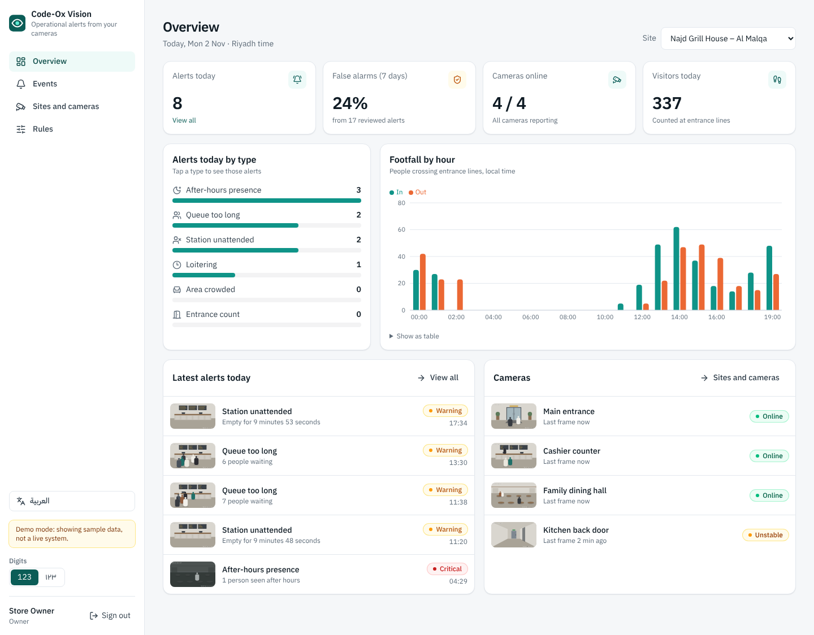
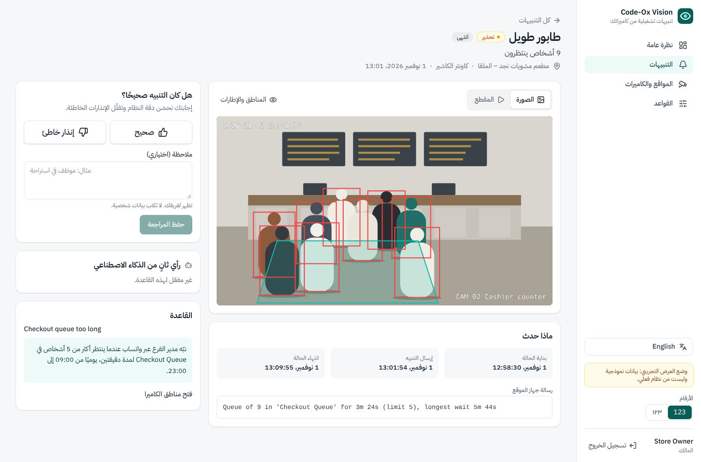
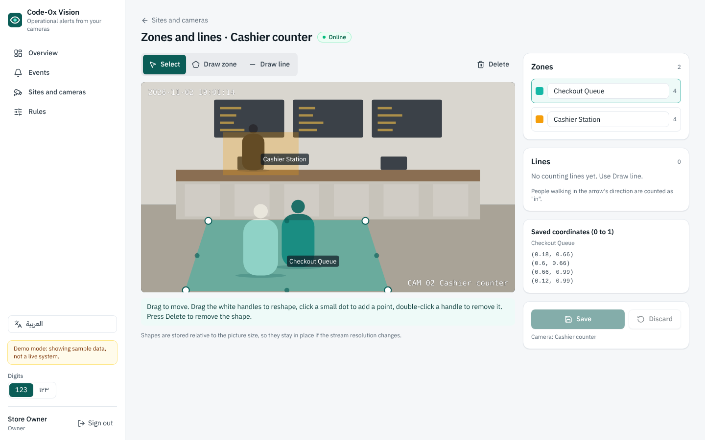

# Code-Ox Vision dashboard (`web/`)

React dashboard for managers and owners: site overview, the live event feed, event detail with
"Correct" / "False alarm" review, sites and cameras, the zone and line editor, and the rule builder.
Arabic and English with right-to-left layout, and a phone layout for managers who tap through from
WhatsApp. Tasks WEB-01 to WEB-09, WEB-11 and WEB-16 in `docs/development-task-plan.md`.

Stack: Vite, React, TypeScript, Tailwind CSS, TanStack Query, React Router, react-konva, react-i18next,
Recharts, lucide-react. All MIT, Apache-2.0 or ISC (see `docs/approved-libraries.md`).

## Run it

Node 22.22 or newer.

```bash
cd web
npm ci
npm run dev          # http://localhost:5173 with demo data
```

Sign in with any email address and the password `demo1234` (mock mode only).

| Command               | What it does                                                                                       |
| --------------------- | -------------------------------------------------------------------------------------------------- |
| `npm run dev`         | Dev server                                                                                         |
| `npm run build`       | Type-check, then production build into `dist/`                                                     |
| `npm run preview`     | Serve the build on http://localhost:4173                                                           |
| `npm test`            | Vitest unit and component tests                                                                    |
| `npm run lint`        | ESLint and Prettier check                                                                          |
| `npm run typecheck`   | TypeScript only                                                                                    |
| `npm run i18n:check`  | Fails if `en.json` and `ar.json` differ in keys or `{{placeholders}}`, or code uses an unknown key |
| `npm run licences`    | Fails on copyleft or non-commercial npm licences                                                   |
| `npm run gen:types`   | Regenerates `src/api/types.ts` from `src/api/schema.json`                                          |
| `npm run screenshots` | Retakes `docs/screenshots/*.png` from a running preview (needs Playwright with Chromium)           |

CI: `.github/workflows/web.yml` runs install, licence guard, lint, typecheck, i18n check, tests and
build, plus a contract job that fails if the generated schema or types are out of date.

## How the data layer works

```
vision_shared (pydantic) --scripts/export_json_schema.py--> src/api/schema.json
                         --json-schema-to-typescript-----> src/api/types.ts   (Zone, Line, Rule, Event, ...)
src/api/models.ts   view types the API adds around them (camera status, signed media URLs, feedback)
src/api/client.ts   ApiClient interface: the only way screens reach data
src/api/http.ts     HttpApiClient: fetch against VITE_API_BASE_URL with a bearer token
src/api/mock/       MockApiClient: in-memory demo data
```

When a shared schema changes: `uv run python scripts/export_json_schema.py` from the repo root, then
`npm run gen:types` here, and commit both files. Every field is required in the generated types
because the cloud always serialises defaults.

Coordinates: zones and lines are stored normalised 0..1 (x right, y down), exactly as in
`vision_shared.schemas`. The editor converts to stage pixels only for drawing
(`src/lib/geometry.ts`, unit tested). For a counting line, "in" means crossing from the left to the
right of start -> end; the editor draws an arrow on the "in" side.

Times: the API speaks ISO 8601 UTC. Screens show the site's timezone (default `Asia/Riyadh`), using
the Gregorian calendar in Arabic and a 24-hour clock. Users can pick Western or Arabic-Indic digits.

## The mock

With `VITE_API_BASE_URL` empty, `createApiClient()` returns `MockApiClient`:

- Three fictional Riyadh sites: a restaurant (4 cameras), a pharmacy (3) and a distribution centre
  (4), with English and Arabic names, zones, lines, recipients and 16 rules across the six rule types.
- About 60 events over the last 7 days, generated from a fixed seed relative to "now", inside each
  rule's schedule, with edge-style messages, detection boxes, AI check results and reviews.
- Snapshots are drawn as SVG scenes (counter, entrance, dining hall, corridor, dock, racking aisle)
  with faceless silhouettes; clips are animated SVGs. No photos.
- Writes are validated like the pydantic models: points outside 0..1, duplicate ids, rules without
  a zone or line, and deleting a zone or line that a rule uses are all rejected.
- A new queue alert appears every 90 seconds so the feed's 10-second polling has something to show.
- State lives in memory and resets on reload.

## Pointing at the real API

```bash
cp .env.example .env.local
# .env.local
VITE_API_BASE_URL=https://api.example.sa/v1
```

Nothing else changes. The session token is sent as `Authorization: Bearer <token>`; a 401 signs the
user out.

### API contract the backend must match

Paths are relative to `VITE_API_BASE_URL`. Shapes are in `src/api/models.ts`.

| Method and path                                                                       | Request                                                                                   | Response                                                                                                        |
| ------------------------------------------------------------------------------------- | ----------------------------------------------------------------------------------------- | --------------------------------------------------------------------------------------------------------------- |
| `POST /auth/login`                                                                    | `{email, password}`                                                                       | `Session {access_token, user {id, name, email, role}}`                                                          |
| `POST /auth/logout`                                                                   |                                                                                           | 204                                                                                                             |
| `GET /sites`                                                                          |                                                                                           | `SiteSummary[]` (adds `name_ar`, `industry`, `city`, camera counts, `alerts_today`)                             |
| `GET /sites/{id}/overview?date=YYYY-MM-DD`                                            | local date in the site timezone                                                           | `SiteOverview` (alerts by rule type, 7-day false-alert rate, footfall by local hour, cameras online)            |
| `GET /cameras?site_id=`                                                               |                                                                                           | `CameraView[]` = `CameraConfig` + `site_id`, `name_ar`, `status`, `last_frame_at`, `snapshot_url`, `resolution` |
| `GET /cameras/{id}`                                                                   |                                                                                           | `CameraView`                                                                                                    |
| `PUT /cameras/{id}/geometry`                                                          | `{zones: Zone[], lines: Line[]}`                                                          | `CameraView`; 422 on invalid geometry, 409 when a rule still uses a removed zone or line                        |
| `GET /sites/{id}/rules`                                                               |                                                                                           | `{rule: Rule, recipient_ids: string[]}[]`                                                                       |
| `POST /sites/{id}/rules`                                                              | `{rule: Rule, recipient_ids}`                                                             | the same                                                                                                        |
| `GET /sites/{id}/recipients`                                                          |                                                                                           | `Recipient[] {id, name, name_ar, channel}`                                                                      |
| `GET /events?site_id&camera_id&rule_type&severity&state&verdict&from&to&cursor&limit` | `from` inclusive, `to` exclusive, ISO UTC; `verdict` = `correct`, `false_alarm` or `none` | `{items: EventView[], next_cursor}`, newest first                                                               |
| `GET /events/{id}`                                                                    |                                                                                           | `EventView` = `Event` + `snapshot_url`, `clip_url` (signed URLs), `feedback`                                    |
| `POST /events/{id}/feedback`                                                          | `{verdict, note}`                                                                         | `EventView`                                                                                                     |

Optional `Event.attributes` the dashboard reads: `boxes` (normalised `[x1, y1, x2, y2]` list drawn
over the snapshot) and `ai_check` (`{verdict: confirmed|rejected|unsure, reason}`).
`CameraConfig.source` should come back with credentials masked.

## Arabic and right-to-left

All visible strings are in `src/i18n/en.json` and `src/i18n/ar.json`. Arabic uses i18next plural
forms (zero, one, two, few, many, other), so "دقيقتين" and "5 أشخاص" come out right. Switching
language sets `lang` and `dir` on `<html>`; layouts use logical Tailwind utilities (`ms-`, `pe-`,
`start-`, `text-start`) and direction-dependent icons flip with `rtl:-scale-x-100`. The camera canvas
and snapshots stay left-to-right because the picture is not mirrored. The font is IBM Plex Sans
Arabic, self-hosted from `public/fonts/` (SIL OFL 1.1), so browsers do not call Google.

## Screenshots

Taken with `npm run screenshots` against `vite preview` (mock data), desktop 1440 px and phone 390 px.

| Screen       | English                                                                                                             | Arabic                                                                                                              |
| ------------ | ------------------------------------------------------------------------------------------------------------------- | ------------------------------------------------------------------------------------------------------------------- |
| Overview     | [desktop](../docs/screenshots/overview-en-desktop.png) · [phone](../docs/screenshots/overview-en-phone.png)         | [desktop](../docs/screenshots/overview-ar-desktop.png) · [phone](../docs/screenshots/overview-ar-phone.png)         |
| Event feed   | [desktop](../docs/screenshots/event-feed-en-desktop.png) · [phone](../docs/screenshots/event-feed-en-phone.png)     | [desktop](../docs/screenshots/event-feed-ar-desktop.png) · [phone](../docs/screenshots/event-feed-ar-phone.png)     |
| Event detail | [desktop](../docs/screenshots/event-detail-en-desktop.png) · [phone](../docs/screenshots/event-detail-en-phone.png) | [desktop](../docs/screenshots/event-detail-ar-desktop.png) · [phone](../docs/screenshots/event-detail-ar-phone.png) |
| Zone editor  | [desktop](../docs/screenshots/zone-editor-en-desktop.png) · [phone](../docs/screenshots/zone-editor-en-phone.png)   | [desktop](../docs/screenshots/zone-editor-ar-desktop.png) · [phone](../docs/screenshots/zone-editor-ar-phone.png)   |
| Rule builder | [desktop](../docs/screenshots/rule-builder-en-desktop.png) · [phone](../docs/screenshots/rule-builder-en-phone.png) | [desktop](../docs/screenshots/rule-builder-ar-desktop.png) · [phone](../docs/screenshots/rule-builder-ar-phone.png) |
| Sign-in      | [desktop](../docs/screenshots/sign-in-en-desktop.png) · [phone](../docs/screenshots/sign-in-en-phone.png)           | [desktop](../docs/screenshots/sign-in-ar-desktop.png) · [phone](../docs/screenshots/sign-in-ar-phone.png)           |





## Not done yet

Invitation, password reset and 2FA screens (WEB-04 covers sign-in only here), token refresh,
recipients (WEB-10), all-sites view (WEB-12), users and roles (WEB-13), audit log (WEB-14), admin
console (WEB-15), WhatsApp deep links (WEB-17), the performance and accessibility pass (WEB-18),
industry rule templates (DET-08), live per-zone counts in the editor, adding cameras from the
dashboard, and editing or disabling existing rules.
